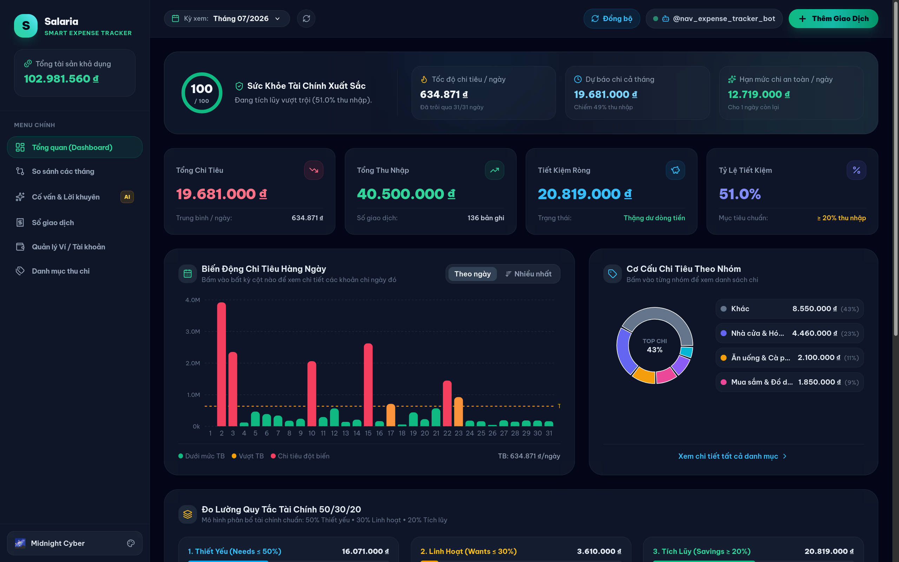
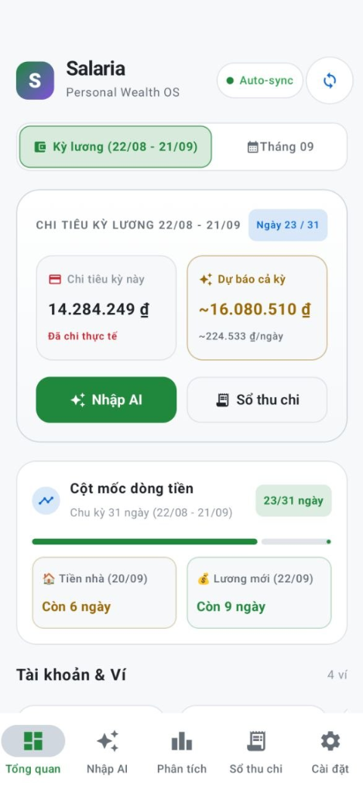
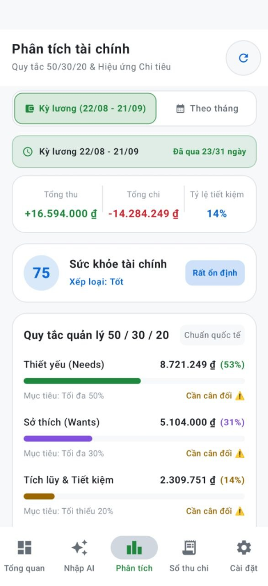
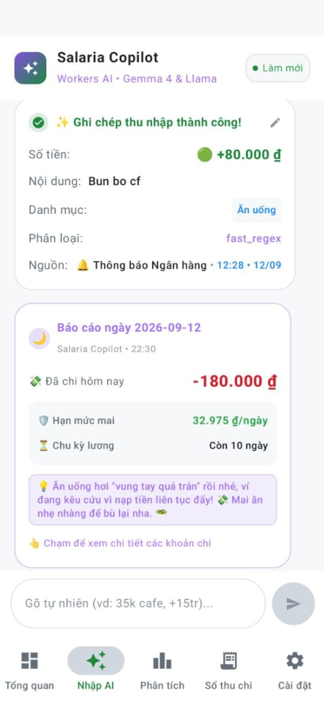

# 💎 Salaria

> **Vừa quẹt 35k ly cà phê hay chuyển khoản 500k đi chợ? Đừng tốn công mở app ghi chép tay.**  
> Hầu hết mọi người đều bỏ cuộc quản lý chi tiêu chỉ sau vài tuần vì việc nhớ và nhập từng khoản tiền lẻ quá phiền phức và dễ quên. **Salaria** giải quyết trọn vẹn việc này: Tự động bắt biến động số dư ngân hàng 24/7, AI phân loại tức thì trong < 0.2 giây và tính sẵn hạn mức bạn được tiêu an toàn mỗi ngày.

  
  
  
  

   
  <em>Bảng điều khiển giám sát dòng tiền và vận hành tài chính trung tâm (Desktop Web)</em>

| 📱 Dashboard Kỳ Lương | 📊 Phân Tích 50/30/20 | 🌙 Báo Cáo Tổng Kết 22h30 |
| :---: | :---: | :---: |
|  |  |  |
| *Dự báo chi tiêu & Burn Rate* | *Kiểm soát 3 trụ cột ngân sách* | *Báo cáo digest & Lời khuyên AI* |

---

## 💡 Vấn Đề & Cách Thức Giải Quyết (Problem & Solution)

* **Vấn đề thực tế:** Người dùng thường nhanh chóng bỏ cuộc vì việc mở app nhập từng khoản tiền lẻ quá phiền phức. Các app ngân hàng chỉ thông báo số dư biến động mà không hỗ trợ phân bổ ngân sách hay cảnh báo bội chi kịp thời.
* **Cách Salaria giải quyết:**
  * **Tự động bắt giao dịch 24/7:** Dịch vụ ngầm tầng OS tự động bắt thông báo từ MSB, Vietcombank, Techcombank, MoMo, ZaloPay... ngay khi phát sinh giao dịch mà không cần người dùng mở app.
  * **Phân loại AI tức thì (< 200ms):** Mô hình AI biên (Edge AI) tự động đọc hiểu ngữ cảnh quán xá, thương hiệu và xếp vào đúng nhóm chi tiêu.
  * **Chủ động bảo vệ dòng tiền:** Tính toán tốc độ đốt tiền (Burn Rate) và hạn mức chi an toàn còn lại mỗi ngày theo chuẩn 50/30/20, ngăn ngừa nguy cơ "cháy túi" trước ngày nhận lương.

---

## 📌 Hiệu Quả Đo Lường Nghiệp Vụ (Measurable Impact)

| Chỉ số vận hành (KPI) | Trước khi tự động hóa | Sau khi triển khai Salaria | Hiệu quả đạt được |
| :--- | :--- | :--- | :--- |
| **Thời gian chu kỳ (Cycle Time)** | 2 - 24 giờ / giao dịch | **< 200 ms** (Tức thì ngay khi có thông báo) | **Giảm 99.9%** độ trễ |
| **Thao tác thủ công** | 100% nhập liệu tay | **< 5%** (Chỉ duyệt khi có ngoại lệ) | **Tự động hóa 95%** quy trình |
| **Tỷ lệ sót giao dịch nhỏ** | ~ 35% các khoản chi nhỏ | **0%** (Tự động ghi nhận mọi giao dịch vi mô) | Triệt tiêu thất thoát dòng tiền |
| **Độ toàn vẹn số dư** | Dễ lệch do quên ghi chép | **100%** khớp chuẩn số dư ngân hàng | Đảm bảo tính nhất quán dữ liệu |

---

## ⚡ Điểm Nhấn Kiến Trúc & Vận Hành (Key Highlights)

* **Thu thập sự kiện thời gian thực (Real-Time Ingestion):** Dịch vụ ngầm tầng OS trên Android tự động bắt biến động số dư 24/7. Thuật toán Title-First lọc sạch dữ liệu rác trước khi truyền tin.
* **Logic phân loại 3 tầng & Human-in-the-Loop:** Kết hợp Regex ranh giới từ (0ms), AI suy luận ngữ cảnh tại Edge (<200ms) và trạm kiểm soát Safe Fallback. Các giao dịch mơ hồ được giữ trạng thái an toàn để người dùng duyệt, hỗ trợ lệnh `/undo`.
* **Bảo vệ quyền riêng tư (Privacy-by-Design):** Xử lý lọc dữ liệu trực tiếp trên thiết bị. Không truy cập hoặc lưu trữ tài khoản ngân hàng, mật khẩu hay mã OTP. Xác thực bằng mã PIN 6 số và tự động khóa phiên khi rời ứng dụng.
* **Độ bền vững khi mất mạng (Offline Resilience):** Hàng đợi Room DB và WorkManager tự động tích lũy và đồng bộ giao dịch khi thiết bị có kết nối trở lại.

---

## 🛠️ Công Nghệ Sử Dụng (Tech Stack)

* **Mobile App:** Android Native (Kotlin, Jetpack Compose, Room DB, WorkManager).
* **Backend:** Cloudflare Workers (TypeScript, REST API).
* **Database:** Cloudflare D1 (Serverless Relational SQLite tại mạng Edge).
* **AI Engine:** Cloudflare Workers AI (Llama 3.2 3B bóc tách giao dịch; Gemma 4 26B cố vấn tài chính).
* **Web Client:** React 18, Vite, TypeScript, Tailwind CSS, Session PIN Security.

---

## 🔒 Bản Quyền & Liên Hệ (Portfolio Showcase)

Dự án này là tài sản trí tuệ cá nhân phục vụ mục đích **Portfolio Showcase & Đánh giá năng lực kỹ thuật**. Mã nguồn đầy đủ và bản demo trực tiếp được cung cấp cho nhà tuyển dụng theo yêu cầu.

* **Tác giả:** Đỗ Ý (dynavv)
* **GitHub Profile:** https://github.com/dynavv
