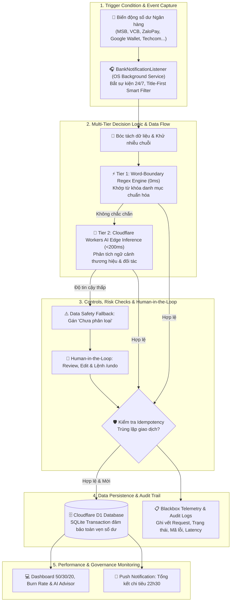
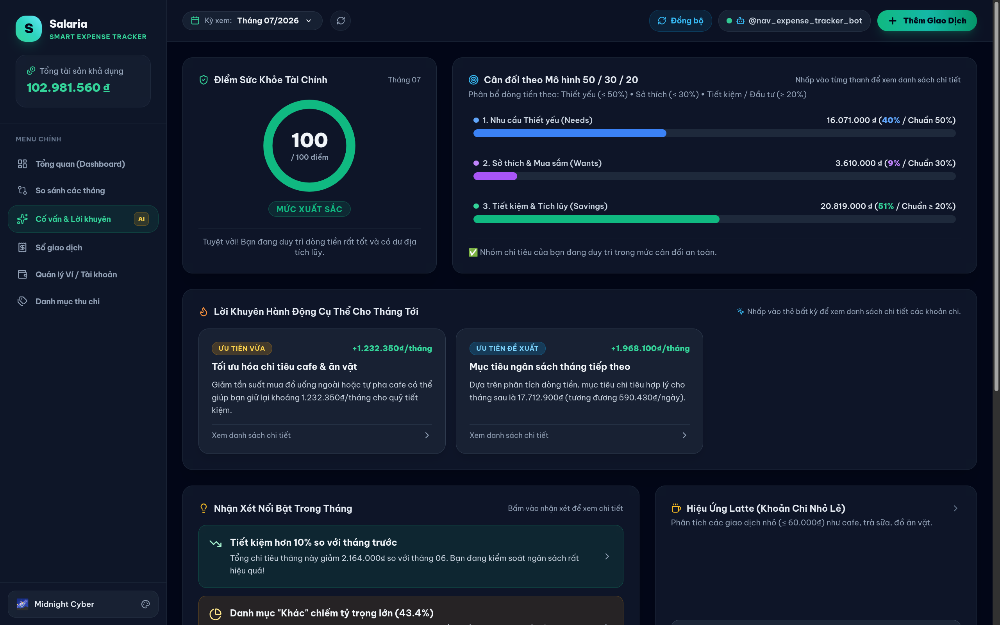

# 💎 Salaria: Automated Fintech Workflow & Financial Governance Engine

> **A Real-World Case Study on End-to-End Process Automation, Risk-Controlled AI Workflows, and Operational Telemetry.**

  
  
  
  

   
  <em>Bảng điều khiển giám sát dòng tiền và vận hành tài chính trung tâm (Salaria Desktop Web)</em>

---

## 📌 Executive Summary

Trong quản trị tài chính và vận hành dòng tiền, việc thu thập và phân loại giao dịch thủ công luôn là điểm nghẽn lớn nhất. Quy trình truyền thống tốn nhiều thời gian, dễ sai sót dữ liệu và thiếu tính kịp thời. 

**Salaria** là giải pháp tự động hóa toàn diện quy trình ghi nhận tài chính thời gian thực. Hệ thống ứng dụng kiến trúc hướng sự kiện (Event-Driven), công nghệ lắng nghe biến động ngầm tầng hệ điều hành, mô hình phân loại dữ liệu AI đa tầng kết hợp trạm kiểm soát rủi ro (Human-in-the-Loop) và bảng điều khiển trực quan hóa hiệu năng dòng tiền.

---

## 🔍 1. Phân Tích Hiện Trạng & Điểm Nghẽn Quy Trình (Current-State Inefficiencies)

Trước khi tái thiết kế, quy trình quản lý giao dịch thủ công bộc lộ 4 điểm nghẽn nghiêm trọng:

| Tiêu chí quy trình | Quy trình thủ công truyền thống | Rủi ro & Hệ quả vận hành |
| :--- | :--- | :--- |
| **Độ trễ ghi nhận (Cycle Time)** | 2 đến 24 giờ sau khi phát sinh giao dịch. | Dữ liệu dòng tiền luôn bị trễ, không cảnh báo kịp thời khi vượt hạn mức chi tiêu. |
| **Công sức nhập liệu (Manual Effort)** | Người dùng phải mở app, gõ số tiền, chọn ví và danh mục cho từng khoản chi. | Tỷ lệ bỏ cuộc cao, bỏ sót các giao dịch nhỏ lẻ (Hiệu ứng Latte). |
| **Sai lệch dữ liệu (Error Rate)** | Nhầm lẫn giữa số tiền chi thực tế và số dư biến động; phân loại sai hạng mục. | Báo cáo tài chính sai lệch, ảnh hưởng đến kế hoạch ngân sách 50/30/20. |
| **Kiểm soát & Đối soát (Reconciliation)** | Khó đối soát khi có giao dịch trùng lặp hoặc giao dịch bị sửa đổi. | Thiếu nhật ký kiểm toán (Audit Trail) để truy vết nguyên nhân sai lệch số dư. |

---

## 🚀 2. Tái Thiết Kế Quy Trình Vận Hành Tương Lai (Target-State Operating Model)

Salaria thay thế hoàn toàn các bước thủ công bằng luồng tự động hóa khép kín:

---

## ⚙️ 3. Thiết Kế Logic Quyết Định & Xử Lý Ngoại Lệ (Decision Logic & Exception Paths)

Quy trình tự động hóa được xây dựng với cấu trúc kiểm soát chặt chẽ nhằm triệt tiêu rủi ro sai lệch dữ liệu:

### 1. Phân loại tự động 3 tầng (3-Tier Classification Engine)
* **Tier 1 (Deterministic Rules - 0ms):** Sử dụng Regex có ranh giới từ (`word-boundary`) để khớp các giao dịch định danh rõ ràng. Ngăn chặn triệt để hiện tượng va chạm từ con.
* **Tier 2 (AI Edge Inference - < 200ms):** Kích hoạt mô hình ngôn ngữ nhỏ (Llama 3.2 3B) trên Cloudflare Workers AI để suy luận các nội dung phức tạp (tên quán ăn, mã chuyển khoản, thương hiệu dịch vụ).
* **Tier 3 (Safe Fallback):** Khi AI không đủ cơ sở xác định, hệ thống không đoán mò. Giao dịch được gán trạng thái an toàn `Chưa phân loại`.

### 2. Trạm kiểm soát con người (Human-in-the-Loop Checkpoints)
* Các giao dịch ở trạng thái `Chưa phân loại` sẽ được đưa vào danh sách chờ duyệt trực quan trên ứng dụng.
* Hỗ trợ lệnh `/undo` và giao diện chỉnh sửa nhanh (BottomSheet) để người vận hành can thiệp ngay lập tức khi phát hiện ngoại lệ.

### 3. Đảm bảo toàn vẹn giao dịch và tính Idempotent
* **Chống trùng lặp (De-duplication):** Mỗi biến động số dư được kiểm tra hash định danh. Nếu hệ thống nhận nhiều webhook trùng nhau từ mạng viễn thông, các bản tin sau sẽ tự động bị bỏ qua.
* **Toàn vẹn số dư chuyển khoản:** Mọi thao tác điều chuyển giữa các tài khoản được bọc trong một Database Transaction duy nhất. Số dư nguồn giảm thì số dư đích phải tăng tương ứng, không bao giờ xảy ra tình trạng mất cân đối kế toán.

---

## 🛡️ 4. Kiểm Soát Tuân Thủ, Nhật Ký Kiểm Toán & Bảo Mật (Compliance & Risk Controls)

Hệ thống được thiết kế theo nguyên tắc bảo mật tích hợp (Privacy-by-Design), đáp ứng các chuẩn mực an toàn dữ liệu tài chính:

* **Bảo vệ quyền riêng tư tuyệt đối (Zero Data Leakage):** 
  * Dịch vụ lắng nghe thông báo chỉ xử lý cục bộ trên thiết bị di động.
  * Chỉ có thông tin số tiền và nội dung thanh toán đã khử nhiễu mới được gửi lên backend qua giao thức HTTPS có khóa bảo mật (`x-api-key`). 
  * Tuyệt đối không bao giờ truy cập hoặc lưu trữ thông tin đăng nhập ngân hàng, mật khẩu, mã OTP hay số thẻ tín dụng.
* **Nhật ký kiểm toán toàn diện (Audit Trail & Telemetry):**
  * Toàn bộ sự kiện Ingest, thời gian phản hồi (latency), mã phản hồi HTTP và ngoại lệ đều được ghi lại trong bảng `telemetry_logs`.
  * Cho phép truy vết nguyên nhân gốc rễ (Root Cause Analysis) khi phát sinh lỗi hệ thống.
* **Khóa phiên bảo mật đa tầng (Session PIN Lock):**
  * Tích hợp cơ chế tự động khóa màn hình với mã PIN 6 số khi đóng tab trình duyệt hoặc rời ứng dụng.
  * Ngăn ngừa hoàn toàn rủi ro truy cập trái phép trên các thiết bị chia sẻ.

---

## 📊 5. Đo Lường Tác Động & Hiệu Quả Nghiệp Vụ (Measurable Impact & KPIs)

Việc áp dụng giải pháp công nghệ đã tạo ra những cải tiến đo lường được rõ rệt:

| Chỉ số vận hành (KPI) | Trước khi tự động hóa | Sau khi triển khai Salaria | Mức độ cải thiện |
| :--- | :--- | :--- | :--- |
| **Thời gian chu kỳ (Cycle Time)** | 2 - 24 giờ / giao dịch | **< 200 ms** (Tức thì ngay khi nhận thông báo) | **Giảm 99.9%** độ trễ |
| **Công sức nhập liệu thủ công** | 100% thao tác tay | **< 5%** (Chỉ can thiệp khi có giao dịch mơ hồ) | **Tự động hóa 95%** quy trình |
| **Tỷ lệ bỏ sót giao dịch nhỏ** | ~ 35% các khoản chi nhỏ | **0%** (Tự động bắt toàn bộ giao dịch vi mô) | Triệt tiêu thất thoát dòng tiền |
| **Độ toàn vẹn số dư ví** | Dễ lệch do quên ghi chép | **100%** khớp với số dư ngân hàng thực tế | Đảm bảo dữ liệu đối soát |
| **Tính khả dụng khi mất mạng** | Thất lạc dữ liệu khi mất sóng | Hàng đợi **Room DB + WorkManager** tự động đồng bộ khi có mạng | Không gián đoạn quy trình |

---

## 📱 6. Giao Diện Báo Cáo & Giám Sát Hiệu Suất (Operations Dashboards)

| 📱 Dashboard Kỳ Lương & Hạn Mức | 📊 Phân Tích Cơ Cấu 50/30/20 | 🌙 Báo Cáo Tổng Kết 22h30 |
| :---: | :---: | :---: |
|  |  |  |
| *Dự báo chi tiêu & Tốc độ đốt tiền (Burn Rate)* | *Kiểm soát 3 trụ cột ngân sách chuẩn* | *Báo cáo digest & Lời khuyên tối ưu chi phí* |

   
  <em>Hệ thống phân tích Hiệu ứng Latte và trợ lý AI tối ưu hóa cơ cấu chi phí</em>

---

## 🏗️ 7. Kiến Trúc Kỹ Thuật (Technology Stack)

* **Thiết bị di động (Mobile Client):** Native Android (Kotlin, Jetpack Compose, Room Database, WorkManager Background Engine).
* **Điện toán biên (Edge Backend):** Cloudflare Workers (TypeScript), Serverless REST Architecture.
* **Cơ sở dữ liệu (Database):** Cloudflare D1 (Serverless Relational SQLite tại mạng Edge).
* **Mô hình trí tuệ nhân tạo (AI Engine):** Cloudflare Workers AI (Llama 3.2 3B xử lý bóc tách giao dịch; Gemma 4 26B phân tích cố vấn tài chính).
* **Bảng điều khiển Web (Desktop Web):** React 18, TypeScript, Tailwind CSS, Lucide Icons, Session PIN Security.

---

## 🔒 8. Bản Quyền & Thông Tin Liên Hệ (Portfolio Showcase Notice)

Dự án này là tài sản cá nhân được xuất bản dưới hình thức **Case Study Kỹ thuật & Portfolio Triển khai Giải pháp**. 

* Toàn bộ mã nguồn cốt lõi được quản lý trong kho lưu trữ riêng (Private Repository).
* Nhà tuyển dụng, đối tác và các bên quan tâm cần xem mã nguồn chi tiết hoặc trao đổi kỹ thuật vui lòng liên hệ trực tiếp:

* **Tác giả:** Đỗ Ý (dynavv)
* **GitHub Profile:** https://github.com/dynavv
